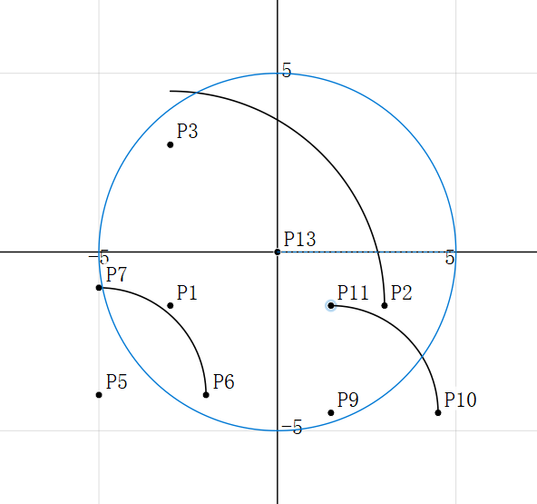
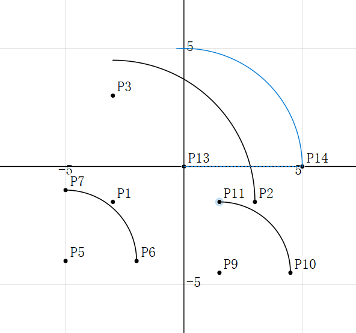

# GeoBoard

**GeoBoard 是一个 Windows 桌面「动态几何画板」**：它记录的是**作图关系**（谁由谁决定）而不是画好的线条，
因此拖动一个自由点时，依赖它的图形会按几何关系自动重算。程序界面全部用 C++ 代码构建，不使用 `.ui` 文件。

- 版本：**0.1.0**（定义在 `src/version.h` 的 `GEOBOARD_VERSION`；根目录 `VERSION` 与 `CHANGELOG.md` 同步维护，
  发布时两处版本号必须一致）
- 技术栈：Qt 5.12.12（QWidget）+ qmake + MSVC，x64 桌面程序
- 文档格式：`.gboard`，UTF-8 编码的 JSON 文本，可人工查看与编辑

## 1. 功能一览

| 分类 | 功能 |
|---|---|
| 基础作图 | 点（自由点）、对象上的点（附着点，只能沿所属对象移动）、线段、射线、直线、圆（圆心 + 圆上一点）、圆弧（三点弧）、多边形（3 个及以上顶点，双击结束） |
| 派生约束 | 中点、垂线、平行线、角平分线、两曲线交点 |
| 测量与标注 | 两点距离、线段长度、角度（三点，顶点居中）、圆半径、**圆周长**、多边形面积、**圆面积**（圆按 πr²、多边形按鞋带公式）、**点坐标标注** |
| 动态重算 | 拖动自由点或附着点时**只重算受影响的子图**；「父 id 必然小于自身 id」的约定使 id 升序天然就是拓扑序 |
| 退化处理 | 三点共线导致外接圆不存在、两曲线无交点、父点位非有限等情况把图元标记为失效（不绘制、不参与交点求解），但**保留在文档中**，位形恢复后自动恢复有效 |
| 编辑 | 选择（Ctrl 加选）、删除选中图元（依赖它的下游一并删除，可撤销）、撤销 / 重做 |
| 视图 | 滚轮以鼠标位置为锚点缩放、中键拖拽平移、网格开关、坐标轴开关、点名与标注开关、放大 / 缩小 / 恢复默认缩放 / 缩放到全部内容 |
| 文件 | 新建 / 打开 / 保存 / 另存为 `.gboard` |
| 界面 | 工具栏 **22 个工具按钮、分两行**（第一行"作图工具"14 个：选择 + 点 / 对象上的点 / 线段 / 射线 / 直线 / 圆 / 圆弧 / 多边形 + 中点 / 垂线 / 平行线 / 角平分线 / 交点；第二行"测量工具"8 个：距离 / 线段长度 / 角度 / 圆半径 / 圆周长 / 多边形面积 / 圆面积 / 点坐标。文字按钮、互斥选中；快捷键 Esc 选择、P 点、S 线段、C 圆、M 中点、I 交点）、状态栏实时显示鼠标坐标与分步操作提示 |
| 演示 | 启动参数 `--demo` 载入内置演示图形，便于快速查看动态重算效果 |

功能全清单（F1–F43）与「明确不做」（N1–N20）见 `docs/requirements.md`。

## 2. 界面全部用 C++ 构建，不使用 `.ui`

界面代码 100% 是 C++：`src/view/GeoBoardMainWindow.cpp` 里手写 `QAction` / `QMenu` / `QToolBar` /
`QStatusBar` 与信号槽连接，`src/view/CanvasWidget.cpp` 用 `QPainter` 自绘画布。`GeoBoard.pro`
里**没有 `FORMS` 段**，构建过程也不经过 `uic`（`.gitignore` 中的 `ui_*.h` 规则只是为了防止误引入生成物）。

这么规定的原因有两条：

1. **`.ui` 难以被 review**。`.ui` 是 XML，界面结构与信号槽连接埋在大量标签里，代码审查时既看不清
   布局层次，也容易漏掉 `connectSlotsByName` 这类隐式行为；同样一份界面，写成 C++ 就能在 diff 里逐行看清。
2. **本项目规定禁止 `.ui`**。该约束写在项目规范里，脚手架生成的 `.pro` 也不含 `FORMS` 段，因此所有界面
   改动都必须落在可审查的 C++ 代码中。

代价是布局代码略长，收益是界面逻辑与业务逻辑的边界在代码里一眼可见。

## 3. 目录结构

```
GeoBoard/
├── GeoBoard.pro                  qmake 工程文件（应用目标；无 FORMS 段，不做 uic）
├── README.md
├── .gitignore
├── VERSION                       版本号（0.1.0），发布时与 src/version.h 保持一致
├── CHANGELOG.md                  变更记录（含开发过程中修复的缺陷与已知问题）
├── scripts/
│   └── build.bat                 已验证的构建脚本（build / test / json / render / package / clean）
├── src/
│   ├── main.cpp                  入口：装配主窗口 + 控制器，处理 --demo
│   ├── version.h                 GEOBOARD_VERSION（0.1.0）
│   ├── model/                    几何内核
│   │   ├── Shape.h / Shape.cpp               图元基类与各类图元（点、线、圆、弧、多边形、中点、交点、测量）
│   │   ├── GeoDocument.h / GeoDocument.cpp   图元集合、依赖图、子图重算、命中测试、选中集
│   │   ├── GeometryMath.h / GeometryMath.cpp 几何算法（交点、外接圆、角平分线、投影、面积等）
│   │   ├── Camera.h / Camera.cpp             视图变换（场景 ↔ 屏幕、缩放、平移、网格步长）
│   │   └── Commands.h / Commands.cpp         撤销 / 重做命令（基于 QUndoCommand）
│   ├── view/                     画布与主窗口装配
│   │   ├── CanvasWidget.h / CanvasWidget.cpp           自绘画布（网格、坐标轴、图元、标注、预览、选中高亮）
│   │   └── GeoBoardMainWindow.h / GeoBoardMainWindow.cpp  菜单 / 两行工具栏 / 状态栏装配（参与构建的主窗口）
│   ├── controller/
│   │   ├── MainController.h / MainController.cpp  工具状态机、拖动与命中决策、撤销栈编排、文件动作
│   │   └── ToolId.h / ToolId.cpp                  22 个工具的枚举与中文名 / 提示 / 所需点击次数
│   └── service/
│       └── JsonStore.h / JsonStore.cpp            .gboard 的 UTF-8 JSON 读写与格式版本校验
├── tests/
│   ├── GeometrySmoke.cpp         无 GUI 的几何引擎自测与性能基准（7 个用例集，81 项断言）
│   ├── GeometrySmoke.pro         几何自测独立工程（只依赖 QtCore 与 src/model）
│   ├── JsonSmoke.cpp             无 GUI 的文件往返自测（保存 → 读回 → 再保存，19 项断言）
│   └── JsonSmoke.pro             往返自测独立工程（QT += core，只编译 src/model 与 src/service/JsonStore）
├── resources/
│   └── app.qrc                   资源文件（当前为空前缀，无图标资源）
└── docs/
    ├── requirements.md           需求（F1–F43 与 N1–N20）
    ├── design.md                 模块划分、信号槽契约、关键决策
    ├── naming.md                 命名规范
    ├── review.md                 代码审查记录
    ├── test.md                   测试记录与手工清单
    ├── optimization.md           优化记录
    ├── package.md                打包说明
    ├── delivery.md               交付说明
    ├── screenshot-demo.png       界面截图（`--demo` 演示图形与动态重算）
    └── screenshot-toolbar.png    界面截图（两行工具栏，22 个工具全部可见）
```

构建产物（`build-release/`、`build-smoke/`、`build-test/`、`build-json/`、`dist/` 等）与中间文件都不在源码树里管理，见 `.gitignore`。

## 4. 构建环境

| 项 | 值 |
|---|---|
| Qt | 5.12.12，msvc2017_64 kit（本机 `D:\Qt\Qt5.12.12\5.12.12\msvc2017_64`） |
| 编译器 | MSVC v143（Visual Studio 2022 Community，工具集 14.44.35207） |
| Windows SDK | 10.0.26100.0 |
| 架构 | x64 |
| 构建系统 | qmake + nmake，C++11 |
| Python | 不需要 |

实测组合：Qt 5.12.12 + MSVC 14.44.35207(v143) + Windows SDK 10.0.26100.0 可正常构建链接。
需要说明的是，Qt 5.12 的 kit 构建于 v141 ABI，与 v143 属于「能构建但有风险」的组合，本机实测通过。

## 5. 构建步骤

### 5.1 用构建脚本（推荐）

```
scripts\build.bat            构建 Release 版程序（产物 build-release\release\GeoBoard.exe）
scripts\build.bat test       构建并运行几何引擎自测（无 GUI 的控制台程序，产物 build-test\release\geometry_smoke.exe）
scripts\build.bat json       构建并运行文件往返自测（保存 → 读回 → 再保存，产物 build-json\release\json_smoke.exe）
scripts\build.bat package    构建 Release 并用 windeployqt 收集运行库到 dist\
scripts\build.bat clean      删除全部构建目录
```

共五种用法：不带参数即构建 Release，另有 `test` / `json` / `package` / `clean` 四个动作。

脚本中的 Qt 与 MSVC 路径来自环境变量 `QTSKILL_QT_DIR` / `QTSKILL_VCVARS`，未设置时使用脚本内的默认值
（本机为 `D:\Qt\Qt5.12.12\5.12.12\msvc2017_64` 与
`D:\Visual Studio\Visual Studio 2022\Community\VC\Auxiliary\Build\vcvars64.bat`）。

脚本刻意写成纯 ASCII（注释用英文）：含中文的 `.bat` 会被 cmd.exe 按 OEM 代码页（简体中文 Windows 上是
GBK/936）读取而乱码，进而破坏命令解析。

### 5.2 手工构建命令（脚本内部就是这些）

```bat
call "D:\Visual Studio\Visual Studio 2022\Community\VC\Auxiliary\Build\vcvars64.bat"
mkdir build-release
cd build-release
"D:\Qt\Qt5.12.12\5.12.12\msvc2017_64\bin\qmake.exe" ..\GeoBoard.pro
nmake
```

注意：`vcvars64.bat` 必须与 `qmake` / `nmake` 在**同一个 cmd 进程**里执行（先 call，再在同一个窗口继续敲
后面的命令），否则 qmake 会直接报 `Project ERROR: Cannot run compiler 'cl'`。
构建始终在独立构建目录里进行，不要在源码树里直接 qmake。

### 5.3 前置条件

- Qt 5.12.x 的 msvc2017_64 kit（含 qmake 与 windeployqt）
- Visual Studio 2019 / 2022，含 MSVC 工具集与 Windows SDK
- 64 位 Windows；Python 不需要
- 源码以 UTF-8 **无 BOM** 保存；`.pro` 已为 MSVC 追加 `/utf-8`，否则中文注释会被按 GBK 解码并抛出
  极具误导性的 `C1075: 未找到匹配令牌`

## 6. 运行

用脚本构建后直接运行：

```bat
build-release\release\GeoBoard.exe
```

直接跑源码树里构建出的 exe 需要能找到 Qt 运行库（本机把 Qt 的 `bin` 放进 `PATH` 即可）。要交给别人的机器运行，
请用第 8 节的打包目录，而不是单独一个 exe。

加 `--demo` 参数会载入一个内置演示图形——以原点为圆心、半径 3 的圆，一条两个端点都附着在该圆上的线段，
线段与圆的交点，线段中点，以及半径 / 线段长度 / 角度三个标注。用选择工具拖动圆上的点或圆心，即可观察
交点、中点与各个标注如何实时跟随。

```bat
build-release\release\GeoBoard.exe --demo
```

### 6.1 鼠标操作一览

| 操作 | 效果 |
|---|---|
| 左键单击图元 | 用选择工具时选中它（按住 Ctrl 或 Shift 点击可多选 / 取消选中） |
| 左键拖动点 | 移动自由点与附着点，依赖它的图形实时跟随 |
| **左键按住起点拖到终点** | **一次拖出线段 / 射线 / 直线 / 圆 / 中点 / 距离**；拖动中有橡皮筋预览（画圆时是预览圆） |
| 左键依次点击两下 | 与上一行等价，也是两点类工具的常规用法：第一下确定起点，第二下确定终点 |
| **双击** | 两点类工具：把双击当作**第一次点击**（确定起点），随后再点一下就完成；多边形工具：结束绘制 |
| **右键按住拖动** | **平移视图**（与中键等效） |
| **右键单击（未拖动）** | **弹出快捷菜单**：在此处添加点 / 从此处画线段 / 以此处为圆心画圆 / 从此处量距离 / 缩放到全部内容 / 删除选中图元 |
| 中键按住拖动 | 平移视图 |
| 滚轮 | 以鼠标位置为锚点缩放 |
| Delete / Backspace | 删除选中的图元（依赖它的图元会一并删除，状态栏会说明数量，可撤销） |
| Esc | 取消当前未完成的作图 |

> 作图工具的三条路径（点两下 / 按住拖出 / 双击起笔）最终汇聚到同一段建图代码，
> 因此行为一致、可以随意混用。垂线、平行线、交点、多边形、圆心式圆弧这类需要
> "先选图元"或"多次点击"的工具不支持一次拖出，按下时状态栏会说明该怎么操作。

### 6.2 圆弧的两种画法

| 工具 | 依次点击 | 特点 |
|---|---|---|
| **圆弧** | 起点 → 弧上一点 → 终点 | 三点定外接圆；**三点共线时该弧失效**（图元保留，位形恢复即自动恢复） |
| **圆弧(圆心)** | 圆心 → 半径点 → 弧上一点 | 圆心与半径由前两点直接给出，**不依赖共线**；弧从半径点起逆时针扫到弧上点 |

圆心式圆弧在教学中更直观（先定圆心、再定半径、最后划范围），拖动时也更稳：
半径只由"圆心到半径点"决定，不会因为某个点偶然落到共线位置而整条弧失效。

**画的时候画布上会有分步反馈**，所以不会出现"点了没反应"：

| 步骤 | 你会看到 |
|---|---|
| 点下圆心 | 圆心处出现点标记 |
| 移动鼠标 | 虚线半径 + 整圆预览，实时跟随鼠标 |
| 点下半径点后移动鼠标 | 虚线半径 + **弧本身**的预览，与最后得到的结果一致 |




### 6.3 吸附对齐、网格精度与缩放

视图菜单的"吸附对齐"控制作图输入的落点，优先级为：

1. **已有点** —— 直接复用，不会在同一个位置叠出第二个点；
2. **栅格** —— 仅在离格点很近时吸附（约 1/4 个吸附单位），离得远时保持自由；
3. **曲线** —— 吸附到线段 / 圆 / 圆弧 / 多边形边上，并创建**附着点**：
   这是结构性约束，拖动时该点只会沿那条曲线滑动，而不是"看起来在线上"。

两个细节值得说明：

- 吸附单位是**整数坐标**（即使视图缩小时网格只画出每隔 2、5、10 个单位的线），
  所以栅格作图拿到的永远是 1、2、3 这样的整数，不会是 0、2、4；
- 状态栏显示的是**鼠标原始坐标**，不是吸附后的坐标——这样你能判断吸附把落点挪了多远。

**坐标轴最小精度**（视图菜单 →「坐标轴最小精度」）控制网格与吸附的颗粒度，
可选 **1 / 2 / 5 / 10 每格**，默认 **1**。它同时决定网格画多细、吸附步进多大
（吸附分辨率由网格步长推出，所以两者永远一致）。

之所以有"每格不少于 1"这个下限：不设下限时，放大到 300% 会让网格细到 0.2，
于是吸附也只能吸到 0.2 的倍数，**就再也点不到整数坐标了**。
调整它只改变网格与吸附的粗细，**不会改动任何已有图形**。

**缩放范围**：可以缩到很小，最大 **300%**。放到 300% 是为了看清小数点后两位的
坐标差异——100% 下相邻的两个点几乎叠在一起。

### 6.4 对象列表（可停靠面板）

右侧默认有一个"对象列表"面板；视图菜单的"对象列表"可以关掉或重新打开，
面板也可以拖到左侧、或拖出来当独立窗口。

| 操作 | 效果 |
|---|---|
| 单击某行 | 选中该对象（按 Ctrl / Shift 可多选）；画布同步高亮，状态栏显示选中数量 |
| 在画布上选中 | 列表里对应行同步高亮（两个方向都能用） |
| 双击某行 | 把视图聚焦到该对象 |
| 右键某行 | 聚焦到此对象 / 删除选中的对象 / 刷新列表 |
| Delete 键 | 删除选中的对象（仍然可撤销，级联删除会在状态栏说明数量） |

列表三列是**编号、类型、说明**（点坐标、圆心与半径、圆弧的构造方式与半径、标注文本……）。
退化失效的图元会标出"（失效）"并整行置灰——这正是几何作图里最需要一眼看出来的状态。
点表头可以排序，排序后选中与删除仍然对应正确的对象（id 存在行数据里，不靠行号反查）。

### 6.5 导出图片

文件菜单 →"导出为图片…"，在保存对话框里选择格式：

| 格式 | 适用场合 | 说明 |
|---|---|---|
| **PNG** | 贴进文档、幻灯片、聊天 | 位图，默认 1600×1200；白底（透明区在 Word/PPT 里会变黑，所以不透明） |
| **SVG** | 论文、课件、需要放大 | 矢量，放大不失真；需要 `Qt5Svg.dll`（交付包已包含） |

导出内容与屏幕所见一致（同一套绘制代码），但**不含**悬停高亮、选中高亮与作图预览——
那些是编辑时的临时状态，不属于作品内容。导出按内容自动适配画幅。

## 7. 自测

自测分**四个互不重叠**的工程，断言数分开统计、不相加：

```bat
scripts\build.bat test       :: 几何引擎（81 项）
scripts\build.bat json       :: 文件往返（19 项）
scripts\build.bat interact   :: 交互 + 面板装配（54 项，合成鼠标事件）
scripts\build.bat render     :: 离屏出图，并实际导出一次 PNG / SVG 校验产物
```

**（1）几何引擎自测**（`scripts\build.bat test`，`tests/GeometrySmoke.cpp`）

- 自测程序是**无 GUI 的控制台程序**，只链接 QtCore 并只编译 `src/model/` 的几何代码。它能编译通过本身
  就说明了一件事：几何内核没有混入任何界面依赖。
- 覆盖 7 个用例集：GeometryMath、依赖重算、**角度测量**、派生图元、退化处理、结构与相机、性能基准。
- 覆盖内容包括交点求解（相交 / 相切 / 重合 / 无交点）、外接圆、角平分线、投影、退化处理、依赖子图重算、
  **角度测量的完整取值链（0° / 45° / 90° / 180° 与两条退化路径）**、
  半径 / 周长 / 圆面积 / 点坐标四种测量的取值与同步更新、「父 id < 自身 id」的拓扑序不变式、相机变换等。
- 本机最近一次实测：**7 个用例集共 81 项断言（10 + 7 + 12 + 26 + 7 + 17 + 2）全部通过，失败 0**，退出码 0。
- 性能基准（991 个图元、链条式深层依赖）：200 次拖动共 14.0–16.0 ms，平均 **0.0700–0.0800 ms/次**，
  远低于需求要求的单次 50 ms；全量命中测试 2000 次平均 **0.089–0.117 ms/次**。
  绝对耗时随机器与当次负载而变，关注的是数量级。

**（2）文件往返自测**（`scripts\build.bat json`，`tests/JsonSmoke.cpp`）

- 它守的是**用户数据安全**那条路径："保存后能否正确打开"。把含全部 11 种图元类型与全部测量类型的
  **26 个图元**文档走一遍 save → load → 再次 save，逐项核对图元总数、关键测量值（含圆面积 πr²）、
  附着点宿主关系、拓扑序不变式、二次往返的文本定点收敛，以及损坏文件被拒绝且不破坏原有文档。
- 用 `QT += core`、只创建 `QCoreApplication`：文件读写属 model / service 层，不需要 GUI。
- 本机最近一次实测：**19 项断言全部通过，失败 0**，退出码 0。

断言清单与手工验收清单见 `docs/test.md`，需求的验收指标见 `docs/requirements.md`。

**（3）交互与面板自测**（`scripts\build.bat interact`，`tests/InteractionSmoke.cpp`）

- 用**合成的鼠标事件**驱动真实窗口（走的是与真机完全相同的
  `mousePressEvent → mouseMoveEvent → mouseReleaseEvent` 路径），检查作图动作是否真的产出了图元。
- 覆盖三条作图路径：点两下、按住拖出、双击起笔；圆与线段各测一遍，另测撤销与重做。
- 存在的理由很实际：用户报告过一次"**画圆失灵**"的回归，靠读代码定位不了；
  最后是这个用例（配合诊断输出）把根因逼出来的——`GeoDocument::allocateShapeId()`
  没有递增，导致同一个动作里"第二个点"和"图形"拿到同一个 id，图形被静默丢弃。
- 本机最近一次实测：**54 项断言全部通过，失败 0**，退出码 0。覆盖：三种作图路径、圆心式圆弧的分步预览与跨工具复位、吸附对齐的语义断言、对象列表停靠窗口、最小精度选项。

**（4）离屏渲染出图**（`scripts\build.bat render`，`tests/RenderDump.cpp`）

把画布的真实 `paintEvent` 渲染到 `docs\screenshot-render.png`。它用于验证**只能用眼睛判断**的改动
（例如圆的抗锯齿），并且不需要打开可见窗口，因此在远程会话或 CI 里也能跑。
出图内容包含圆、三点圆弧、多边形、交点与标注，能够一眼看出圆的边缘是否平滑。

## 8. 交付打包

```bat
scripts\build.bat package
```

该命令先构建 Release，再用 `windeployqt` 把运行库收集到 `dist\`，其中包含：

| 内容 | 说明 |
|---|---|
| `GeoBoard.exe` | 主程序 |
| `Qt5Core.dll` / `Qt5Gui.dll` / `Qt5Widgets.dll` / `Qt5Svg.dll` | Qt 运行库 |
| `platforms\qwindows.dll` | **必需**，缺它程序无法启动 |
| `styles\qwindowsvistastyle.dll` | Windows 原生样式插件 |
| `imageformats\` / `iconengines\` | 图片与图标格式插件 |
| MSVC 运行时 DLL（`msvcp140` / `vcruntime140` 系列） | `windeployqt` 默认收集 |

交付时把整个 `dist\` 目录压缩成一个包再发出去（本项目的交付包命名为 `GeoBoard-0.1.0-win64.zip`）。
**不要只发 `GeoBoard.exe` 单个文件**——目标机缺少平台插件时会直接报
`This application failed to start because no Qt platform plugin could be initialized`。

目标机要求与更细的打包步骤见 `docs/package.md`，交付清单见 `docs/delivery.md`。

## 9. 已知限制

- **圆弧只支持三点弧**：依次点起点、终点、弧上一点。没有「圆心 + 半径」「圆心角」「椭圆」等其它圆弧构造
  方式；三点共线时该弧处于失效状态（不绘制，但对象保留在文档中，位形恢复后自动恢复）。
- **测量值只读，不参与后续作图**：测量结果只用于显示与保存，不能反过来驱动几何（例如不能把某条线段长度
  「锁定」为 5，也不能拿测量值当约束的输入）。这属于需求中明确不做的范围，见 `docs/requirements.md` 第 4 节。
- **界面交互未经人工逐条走查**：功能可用性由几何引擎自测（`scripts\build.bat test`）与手工抽查共同确认，
  尚未按需求清单把每个界面用例逐条人工验证并留档。界面行为受位形组合影响较大，遇到异常请带上复现步骤反馈。
- ~~**状态栏不显示当前选中对象的数量**~~：**该项已实现**（2026-09-27 追加）——状态栏右侧现在显示
  「未选中 / 已选中 N 个」，随选择实时更新（单选、Ctrl 加选、单击空白处清除都会反映出来）。
  实现位置：`GeoBoardMainWindow::setSelectionCount()` 与 `MainController::onSelectionChanged()`。
  此条功能的**截图证据尚未取到**（本机 200% 缩放下状态栏落在截图区域之外），已列入待人工目视复核。
- **派生点不能直接拖动**：中点、交点没有独立自由度（中点由两个端点决定，交点由两条曲线决定），因此拖动它们
  不会移动图形，状态栏会提示「请拖动端点 / 相关曲线的定义点」。要改变它们的位置，请拖动定义它们的自由点。
- **平移 / 缩放后测量标注不跟随图形**：标注文字使用创建时点击位置记录的场景坐标作为锚点，缩放或平移视图后，
  标注仍停在原来的场景位置上，需要重新创建标注或撤销后重做。（见 `CHANGELOG.md` 的已知问题。）
- **工具栏是文字按钮**：未引入图标资源（`resources/app.qrc` 目前是空前缀），这是刻意的取舍，中文界面下文字
  按钮更易读。

## 10. 文档索引

| 文档 | 内容 |
|---|---|
| `docs/requirements.md` | 需求：43 条必须实现的功能（F1–F43）与 20 条明确不做（N1–N20） |
| `docs/design.md` | 模块划分、关键类、信号槽契约与关键决策 |
| `docs/naming.md` | 命名规范与本项目专有术语 |
| `docs/review.md` | 代码审查记录 |
| `docs/test.md` | 测试记录、断言清单与手工测试清单 |
| `docs/optimization.md` | 优化记录（测量方法与回归验证） |
| `docs/package.md` | 打包说明（构建、部署、目标机要求） |
| `docs/delivery.md` | 交付说明（交付内容、已知缺陷、验证记录） |
| `docs/screenshot-demo.png` | 界面截图（`--demo` 演示图形与动态重算） |
| `docs/screenshot-toolbar.png` | 界面截图（两行工具栏，22 个工具全部可见） |
| `CHANGELOG.md`（根目录） | 变更记录：各版本新增内容、开发中修复的缺陷与已知问题 |
